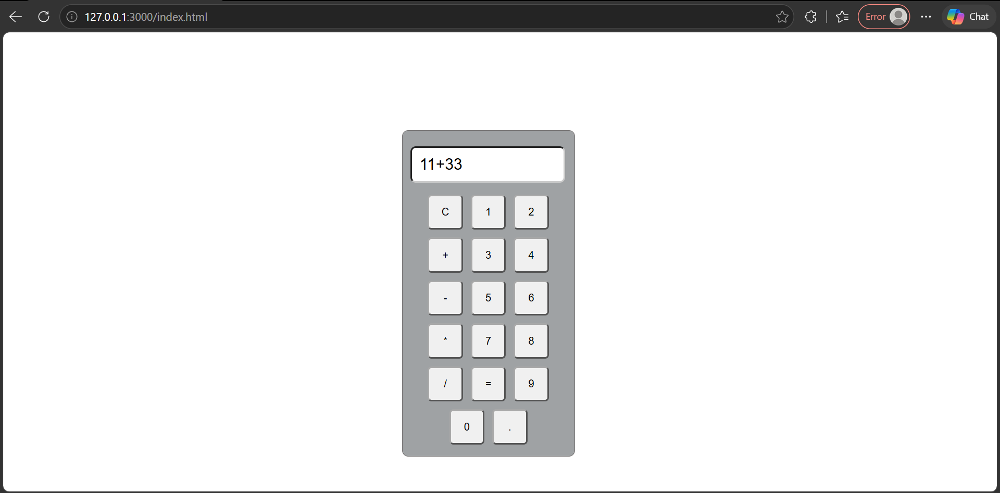

# 🧮 Calculator Project

## 📌 About the Project
This is a simple and interactive Calculator Project built using HTML, CSS, and JavaScript. It performs basic arithmetic operations such as addition, subtraction, multiplication, and division.

The project has a clean and user-friendly interface. JavaScript is written inside the HTML file using the `<script>` tag to handle calculator functionality.

## 🚀 Features
- Addition (+)
- Subtraction (-)
- Multiplication (*)
- Division (/)
- Clear (C) button
- Decimal button
- Interactive calculator buttons
- Simple and responsive design

## 🛠️ Technologies Used
- **HTML5** – Structure of the calculator.
- **CSS3** – Styling and layout using an external `style.css` file.
- **JavaScript** – Calculator functionality using the `<script>` tag inside HTML.

## 📂 Project Structure

```text
Calculator/
│
├── index.html
├── style.css
├── README.md
└── screenshots/
    └── calculator.png
```

## 📸 Screenshots

### Calculator Interface



## ⚙️ How to Run the Project

1. Download or clone this repository.
2. Open the project folder in VS Code.
3. Open `index.html` in your browser.
4. Start using the calculator.

## 👩‍💻 Author

**Khushboo Rajput**

B.Tech Student | Computer Science (AI & ML)

## ⭐ Support

If you like this project, don't forget to give it a star!
